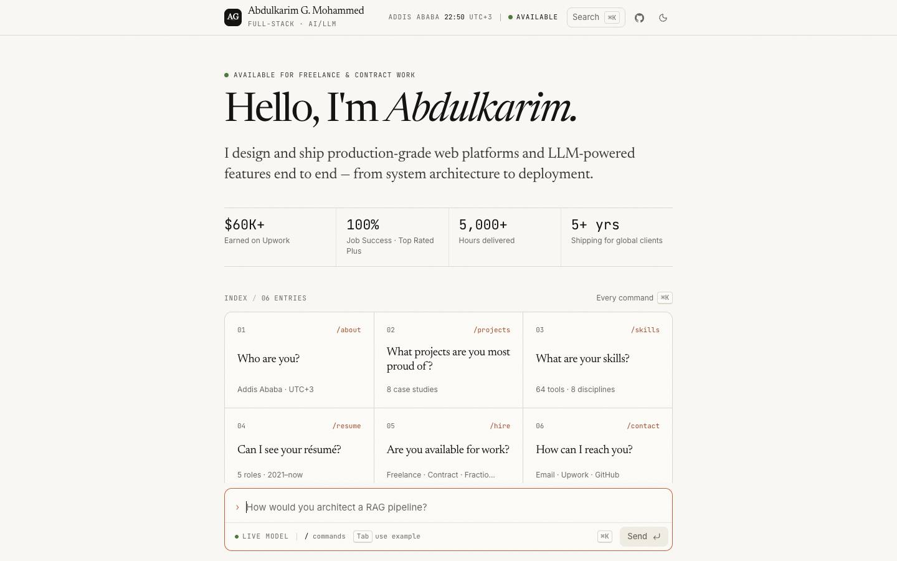
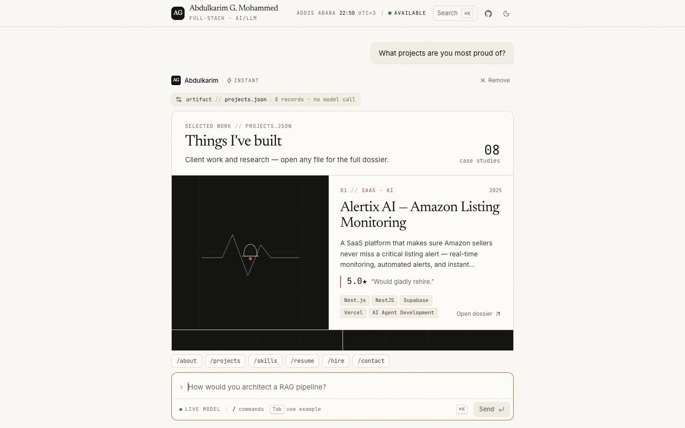
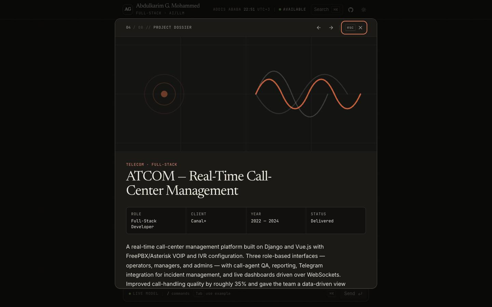
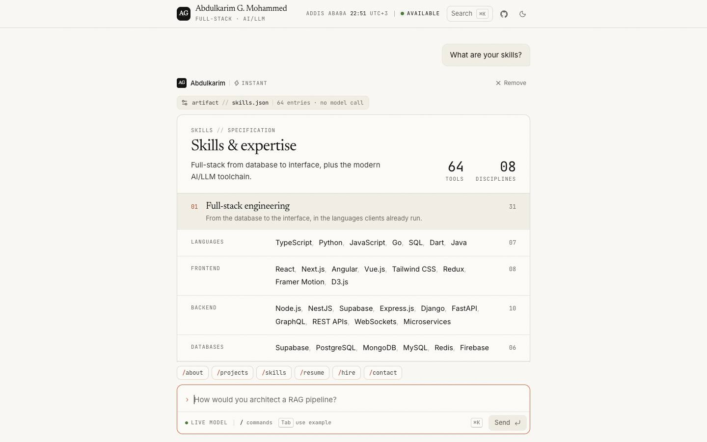
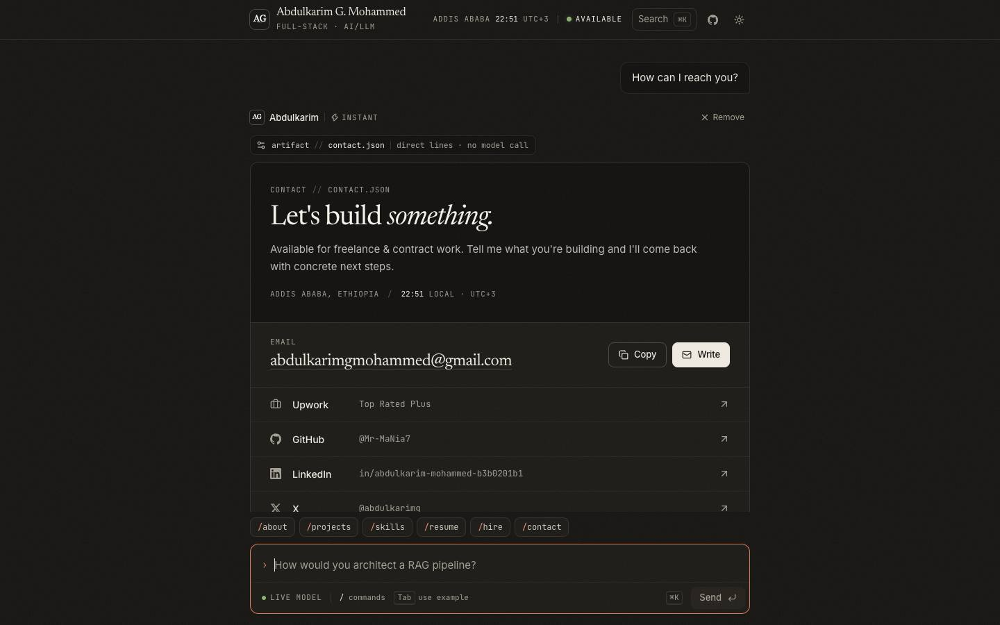
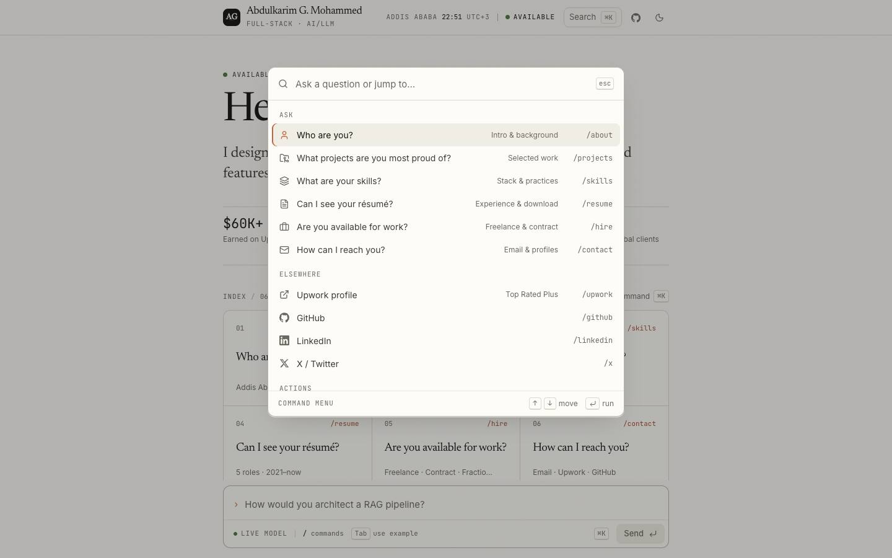
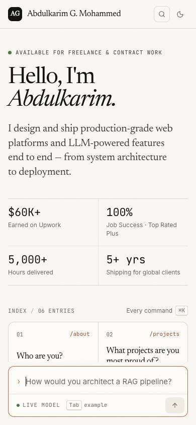
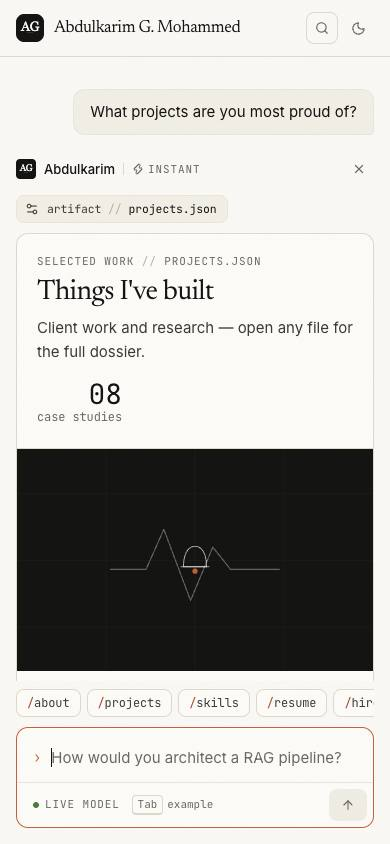
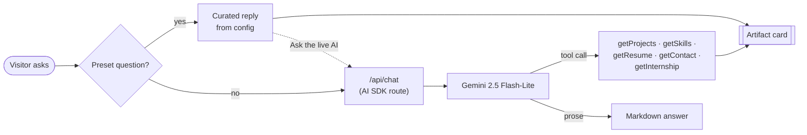

<h1 align="center">Abdulkarim G. Mohammed — Portfolio</h1>

<p align="center">
  <b>A portfolio you talk to.</b><br>
  Ask it anything; it answers as me — and renders the answer as a document, not a chat bubble.
</p>

<p align="center">
  <a href="https://abdulkarimg.com"><b>abdulkarimg.com →</b></a>
  &nbsp;·&nbsp;
  <a href="#quick-start">Run it locally</a>
  &nbsp;·&nbsp;
  <a href="#make-it-yours">Make it yours</a>
</p>

<p align="center">
  
  
  
  
  
  
</p>

<p align="center">
  <picture>
    <source media="(prefers-color-scheme: dark)" srcset="docs/screenshots/landing-dark.jpg">
    
  </picture>
</p>

> **About the developer** — Senior Full-Stack Engineer & AI/LLM Specialist in Addis Ababa. Top Rated Plus on Upwork · 100% Job Success · $60K+ earned across 26 jobs and 4,289 tracked hours.

---

## Why a conversation?

A résumé answers the questions *I* think matter. A conversation answers the ones *you* have.

So the whole site is a chat with a "digital twin". Common questions — projects, skills, résumé, availability, contact — answer **instantly from curated content**, with no API call. Anything else goes to a **live model** that speaks in my voice and can call tools. Either way, the answer arrives as a bespoke **artifact**: an editorial dossier you can read, scan and click through, not a wall of generated text.

## Features

**The conversation**
- **Instant answers, live depth.** Six core questions render immediately from `portfolio-config.json` — zero latency, zero cost, never broken by rate limits. One click on *Ask the live AI* escalates the same question to the model.
- **Tool calls you can see.** When the live model calls a tool, a monospace pill shows it working — `⚙ rendering artifact // projects.json` — then settles above the card it produced.
- **Honest provenance.** Every answer is labelled *Instant* (curated) or *Live model* (generated).
- **Graceful failure.** If the hosted model is rate-limited, the transcript says so and points to everything that still works.

**Navigation, keyboard first**
- **⌘K command palette** — ask a question, open a profile, copy the email, download the résumé, switch theme.
- **Slash commands** — type `/` in the composer for an autocomplete menu with full keyboard support.
- **Ghost suggestions** — the empty composer cycles example questions; `Tab` drops one in.

**The artifacts**
| Ask | You get |
|---|---|
| `/projects` | A bento of case studies with impact callouts and stack tags; each opens a full dossier (← / → to step through). |
| `/skills` | A specification sheet: 8 disciplines grouped into 3 domains, every tool counted. |
| `/resume` | A timeline with expandable highlights, education, research, recognition, and a one-click PDF download. |
| `/hire` | Terms of engagement, Upwork standing, focus areas, and local time in Addis Ababa ("at the desk now"). |
| `/contact` | Email with copy-to-clipboard, and every profile with its handle. |
| `/about` | The bio set as an essay, with a facts ledger. |

**Craft**
- Light and dark themes, each tuned on its own — warm luminance steps, not an inversion.
- Responsive to phone widths; the phone layout is its own composition, not a squeezed desktop.
- WCAG-minded: visible clay focus rings, ARIA combobox/listbox/dialog semantics, focus restored when overlays close, AA-contrast clay for small text.
- Motion that respects `prefers-reduced-motion` everywhere — CSS reveals, Framer Motion overlays, smooth scroll.
- SEO: JSON-LD `Person` schema, dynamic Open Graph image at `/opengraph-image`, sitemap and robots.

<table>
  <tr>
    <td width="50%"></td>
    <td width="50%"></td>
  </tr>
  <tr>
    <td></td>
    <td></td>
  </tr>
  <tr>
    <td></td>
    <td>
      <p align="center">
        
        &nbsp;
        
      </p>
    </td>
  </tr>
</table>

---

## How it works



- **One source of truth.** [`portfolio-config.json`](portfolio-config.json) feeds the UI, the preset answers, the command set *and* the model's system prompt — so the twin can never contradict the page.
- **The same cards, two routes.** Instant answers and live tool calls render through one map, `renderToolArtifact()` in [`tool-renderer.tsx`](src/components/chat/tool-renderer.tsx).
- **One transcript.** Instant answers and AI turns are interleaved chronologically in a single timeline (see `timeline` in [`chat.tsx`](src/components/chat/chat.tsx)).
- **Bounded model.** The route streams with at most two steps and a 30-second ceiling, and the about-me card is deliberately left out of the live tool set so the model answers that one in its own words.

---

## Quick start

Requires Node 20+ and pnpm.

```bash
git clone https://github.com/Mr-MaNia7/portfolio.git
cd portfolio
pnpm install
cp .env.example .env.local    # add your key — see below
pnpm dev                      # http://localhost:3000
```

| Variable | Required | Purpose |
|---|---|---|
| `GOOGLE_GENERATIVE_AI_API_KEY` | For live answers | Free key from [Google AI Studio](https://aistudio.google.com/apikey). Without it, every instant answer, the ⌘K menu and slash commands still work. |
| `NEXT_PUBLIC_SITE_URL` | For production | Your domain — used for canonical URLs, Open Graph and the sitemap. |

| Script | Does |
|---|---|
| `pnpm dev` | Dev server (Turbopack) |
| `pnpm build` | Production build + type check |
| `pnpm start` | Serve the production build |
| `pnpm lint` | ESLint |

> Fonts load from Google Fonts at build time through `next/font`. If the dev server can't reach Google it quietly falls back to a system serif; a production build fails loudly instead.

---

## Make it yours

Fork it, then edit **one file**: [`portfolio-config.json`](portfolio-config.json). Copy, cards, stats, commands, SEO and the AI persona all update from it.

| Section | Drives |
|---|---|
| `personal` | Name, title, tagline, location, timezone (powers the live local clock), email, avatar, bio |
| `stats` | The four figures on the landing page and in the hire/about cards |
| `availability` | The hire dossier — engagement types, mode, start date, focus areas |
| `experience` · `education` | The résumé timeline, research and recognition |
| `skills` | The specification sheet (8 lists, grouped into 3 domains in [`skills.tsx`](src/components/skills.tsx)) |
| `projects` | The bento and dossiers — `metrics` like `"~35% quality improvement"` are split into a big figure and a caption automatically |
| `social` · `resume` | Contact links, slash commands, the PDF download |
| `chatbot` · `presetQuestions` | The twin's tone and the questions it expects |

**Before you ship, swap in your own:**
- **Photo** — `personal.avatar` points at a generated monogram (`/public/avatar.svg`).
- **Résumé** — add `public/resume.pdf` or point `resume.downloadUrl` at a URL.
- **Project imagery** — covers in `/public/covers` are drawn placeholders; real screenshots in `projects[].images` take precedence.

### Add a new artifact

Say you want `/talks`:

1. **Tool** — create `src/app/api/chat/tools/getTalks.ts` (copy `getSkills.ts`) and register it in the `tools` object in [`route.ts`](src/app/api/chat/route.ts).
2. **Card** — build `src/components/talks.tsx` from the primitives in [`artifact/artifact.tsx`](src/components/artifact/artifact.tsx): `Artifact`, `ArtifactHeader`, `ArtifactSection`.
3. **Render** — add a `case 'getTalks'` to `renderToolArtifact()` in [`tool-renderer.tsx`](src/components/chat/tool-renderer.tsx).
4. **Pill** — give it a file name and record count in [`tool-meta.ts`](src/components/chat/tool-meta.ts).
5. **Instant + discoverable** *(optional)* — add a preset in `generatePresetReplies()` and a tool hint in the system prompt ([`config-parser.ts`](src/lib/config-parser.ts)), and a command in [`commands.ts`](src/lib/commands.ts). Its question must match the preset key exactly.

---

## Design system

*A research journal printed on warm stone.* Pages are ivory parchment, ink is near-black slate, and a single terracotta accent is held back for the one action that matters. Surfaces separate by small steps in tone and 1px hairlines — shadows appear only on things that truly float.

| Role | Light | Dark |
|---|---|---|
| Ground · card · sunken | `#faf9f5` · `#fdfcf8` · `#f2efe7` | `#161412` · `#1c1a17` · `#11100e` |
| Ink · soft ink · muted | `#141413` · `#3d3b35` · `#6b6960` | `#ede9df` · `#cbc6b9` · `#a29d91` |
| Hairlines (subtle · default · strong) | `#ebe6db` · `#e0d9cb` · `#b8b2a5` | `#262320` · `#322e29` · `#4a453d` |
| Clay (fill · small text) | `#c6613f` · `#a54a2a` | `#d97757` · `#e8957a` |

- **Type** — [Newsreader](https://fonts.google.com/specimen/Newsreader) with optical sizing for display, [Inter](https://rsms.me/inter/) for reading (capped at 65ch), [JetBrains Mono](https://www.jetbrains.com/lp/mono/) for metadata, commands and tabular figures.
- **Radius** — 4px chips and keys · 8px controls · 12px artifact sheets.
- **Motion** — enter from `translateY(6px)` or `scale(0.97)`, never from zero; `cubic-bezier(0.22, 1, 0.36, 1)`; 150–280ms; staggered like pages laid on a desk.
- **Texture** — a faint fractal-noise paper grain, printed above the page and below overlays.

Tokens live in [`src/app/globals.css`](src/app/globals.css) (`:root` and `.dark`), along with the editorial utilities: `font-display`, `num`, `meta`, `measure`, `hang`, `press`, `reveal`.

---

## Project structure

```
portfolio-config.json            # single source of truth
src/
├─ app/
│  ├─ globals.css                # tokens, utilities, motion
│  ├─ layout.tsx                 # fonts, metadata, JSON-LD
│  ├─ opengraph-image.tsx        # dynamic social card
│  └─ api/chat/                  # streaming route, system prompt, tools/
├─ components/
│  ├─ chat/                      # shell, masthead, landing, composer, ⌘K, turns, tool pills
│  ├─ artifact/                  # Artifact primitives, copy-email control
│  ├─ projects/                  # bento + dossier dialog
│  ├─ presentation · skills · resume · AvailabilityCard · contact
│  └─ ui/                        # Radix-based primitives, brand icons, toaster
├─ hooks/use-local-time.ts       # live clock from the config's UTC offset
├─ lib/
│  ├─ config-loader.ts           # loads + pre-parses the config
│  ├─ config-parser.ts           # system prompt, preset replies, view models
│  └─ commands.ts                # one command set for ⌘K and slash menu
└─ types/portfolio.ts            # config schema
```

**Stack** — Next.js 16 (App Router, Turbopack) · React 19 · TypeScript (strict) · Tailwind CSS v4 · Framer Motion · Vercel AI SDK + Google Gemini · Radix · lucide-react · sonner · Vercel Analytics.

---

## Deploy

Built for **Vercel**:

1. Import the repo at [vercel.com/new](https://vercel.com/new) — Next.js and pnpm are detected.
2. Add `GOOGLE_GENERATIVE_AI_API_KEY` and `NEXT_PUBLIC_SITE_URL` under *Environment Variables*.
3. Deploy.

---

## Credits

This project began as a fork of the open-source [**AI-Powered Portfolio**](https://github.com/anujjainbatu/portfolio) template by **Anuj Jain** ([@anujjainbatu](https://github.com/anujjainbatu)) — full credit for the original conversational-portfolio concept and scaffold, released under the MIT License.

From there, all content was rewritten, the UI/UX redesigned from the ground up, and the stack upgraded (Next.js 16, AI SDK v7). The original license and attribution are preserved in [`docs/LICENSE`](docs/LICENSE).

Thank you, [@anujjainbatu](https://github.com/anujjainbatu).

---

<p align="center">
  Built in Addis Ababa by <a href="https://github.com/Mr-MaNia7">Abdulkarim G. Mohammed</a>.<br>
  <a href="https://www.upwork.com/freelancers/~01dc65c291b2936bc3">Hire me on Upwork</a> · <a href="mailto:abdulkarimgmohammed@gmail.com">abdulkarimgmohammed@gmail.com</a>
</p>
